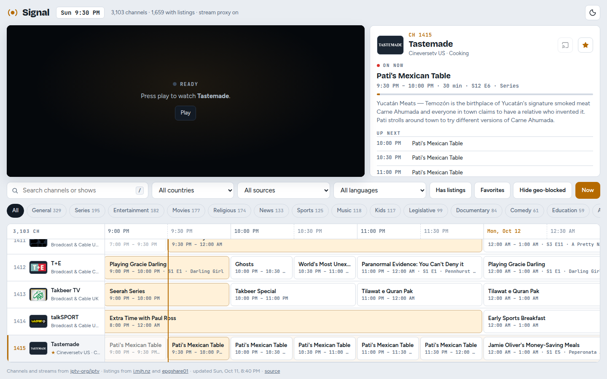

# Signal TV Guide

A self-hosted TV guide and player for the free, publicly listed channels in
[iptv-org/iptv](https://github.com/iptv-org/iptv), with programme listings for
the channels that have them.

<picture>
  <source media="(prefers-color-scheme: dark)" srcset="docs/screenshot-dark.png">
  
</picture>

## Why

iptv-org collects thousands of free, legal streams: broadcast and local
stations, and the free ad-supported services (Pluto TV, Samsung TV Plus, Plex,
Roku and more). They come as M3U playlists, which leave a lot to do: there's no
schedule, many streams won't play in a browser, and finding something to watch
means scrolling a list of names.

Signal turns those playlists into something closer to a TV:

- **A real guide.** A scrolling grid with a live "now" line, built from public
  XMLTV feeds and matched to the channels for you. For the US, about half of
  the 2,200+ channels have listings, including local stations by call sign.
- **A player that copes.** It falls back through a channel's alternate
  streams when one fails, and a small built-in proxy plays streams a browser
  would otherwise refuse (Pluto TV, CORS, required headers).
- **Nothing to configure.** Pick the countries; the guide rebuilds itself
  every hour.

It doesn't host or re-broadcast anything. Every stream comes from the public
links in iptv-org, played from your own machine.

## Features

- Every iptv-org playlist for the countries you choose, merged into one
  numbered channel list, with names, logos, categories and languages from the
  [iptv-org API](https://github.com/iptv-org/api)
- Listings from [i.mjh.nz](https://i.mjh.nz/) (Pluto TV, Samsung TV Plus, Plex,
  Roku, PBS) and [epgshare01](https://epgshare01.online/) (cable networks and
  US local stations), 3 hours back to about 30 hours ahead
- Search across channel names and show titles; filters for country, source,
  language and category; "has listings", favorites and "hide geo-blocked"
- An HLS player ([hls.js](https://github.com/video-dev/hls.js)) with stream
  fallback, and a copy button on every row to open a stream in VLC or mpv
- Casting to Chromecast, Google TV and Nest Hub from Chrome or Edge
- Light and dark themes, keyboard control, and a layout that works on phones
- A TV layout driven by the remote, with full-screen viewing and a channel banner
- Standard-library Python only: no packages to install, ~25 MiB idle

## Quick start

With Docker:

```bash
git clone https://github.com/alanheinen/iptv-epg.git
cd iptv-epg
docker compose up -d
```

Then open <http://localhost:8080>. The first guide build takes about a minute.

Or with nothing but Python 3.9+:

```bash
python3 scripts/serve.py --data data --refresh 1
```

## Install

Every method runs the same server, `scripts/serve.py`, which serves the page,
runs the stream proxy and rebuilds the guide data at startup and every hour.
Each listens on the machine it runs on only, until you change one setting.

> **Keep it off the internet.** Serve it on your own network at most. Exposed
> publicly, the stream proxy is an open relay for anyone's traffic. See
> [SECURITY.md](SECURITY.md).

| Method | Needs | Open it to your network with |
| --- | --- | --- |
| [Docker](#docker) | Docker with Compose | `ports: "8080:8080"` in `docker-compose.yml` |
| [Kubernetes](#kubernetes) | a cluster and `kubectl` | an Ingress, or a Service type of your choice |
| [Linux](#linux-systemd) | Python 3.9+ and systemd | `HOST=0.0.0.0` in `/etc/signal-tv.env` |
| [Windows](#windows) | Python 3.9+ from python.org | `-Lan`, from an administrator PowerShell |

Allow 256 to 512 MiB of memory: about 25 MiB idle, peaking near 150 MiB for
the US during the hourly rebuild (180 MiB for `us,ca,uk`).

### Docker

```bash
docker compose up -d                              # start
docker compose ps                                 # "healthy" once the guide is built
docker compose pull && docker compose up -d       # update
docker compose down                               # stop
```

[`docker-compose.yml`](docker-compose.yml) runs the published image,
`ghcr.io/alanheinen/iptv-epg:latest`, read-only, as UID 1000, with no
capabilities, and keeps the feed cache in a named volume so restarts are ready
in seconds. Set `COUNTRIES` there. `docker compose up -d --build` builds the
image from your checkout instead.

Without Compose:

```bash
docker run -d --name signal-tv --restart unless-stopped \
  -p 127.0.0.1:8080:8080 -e COUNTRIES=us \
  --read-only --cap-drop ALL -v signal-tv-data:/data \
  ghcr.io/alanheinen/iptv-epg:latest
```

The image is built for `linux/amd64`. Each build on `main` is tagged
`sha-<commit>` as well as `latest`; pin one of those, or its digest, if you
don't want updates to arrive on their own.

### Kubernetes

```bash
kubectl apply -k deploy/kubernetes
kubectl -n signal-tv port-forward svc/signal-tv 8080:80     # http://localhost:8080
```

[`deploy/kubernetes`](deploy/kubernetes) is a Kustomize base:

- a `signal-tv` namespace with Pod Security "restricted"
- a one-replica Deployment: non-root, read-only root filesystem, no
  capabilities, and a readiness probe that holds traffic until the guide is
  built
- a Service

Before you deploy:

- Set `COUNTRIES` in `deployment.yaml`.
- Pin the image in `kustomization.yaml` (`newTag: sha-<commit>`, or a digest)
  rather than following `latest`.
- To reach it from your network, fill in [`ingress.yaml`](deploy/kubernetes/ingress.yaml)
  with your host, ingress class and TLS, then add it to the resources.
  Casting needs the page on HTTPS.

Keep it to one replica: each pod builds its own guide, and Pluto sessions
live in the pod.

### Linux (systemd)

```bash
git clone https://github.com/alanheinen/iptv-epg.git
sudo iptv-epg/deploy/linux/install.sh                 # install or update
sudo iptv-epg/deploy/linux/install.sh --uninstall     # remove
```

The script copies the app to `/opt/signal-tv` and installs
[`signal-tv.service`](deploy/linux/signal-tv.service):

- It runs as a throwaway system user (`DynamicUser`), in a tight sandbox
  (`systemd-analyze security` rates it 1.5, "OK").
- Its data lives in `/var/lib/signal-tv`.
- It restarts on failure, with memory capped at 512 MiB.

Settings live in `/etc/signal-tv.env` (`COUNTRIES`, `HOST`, `PORT`). The script
writes that file on first install and never overwrites it after that. Restart
after editing it with `sudo systemctl restart signal-tv`. Logs:
`journalctl -u signal-tv`. To update, `git pull` and run the script again.

### Windows

From PowerShell, in the cloned or downloaded repository:

```powershell
powershell -ExecutionPolicy Bypass -File deploy\windows\install.ps1 -Countries us
powershell -ExecutionPolicy Bypass -File deploy\windows\install.ps1 -Uninstall
```

[`install.ps1`](deploy/windows/install.ps1) copies the app to
`%LOCALAPPDATA%\SignalTV` and registers a scheduled task, "Signal TV Guide". The
task runs the app with `pythonw.exe`, so there's no console window, whenever you
log on. The script also starts it right away.

- **Admin rights:** not needed, except for `-Lan`. That option listens on every
  interface and adds a Windows Firewall rule for Private networks only.
- **Logs:** `%LOCALAPPDATA%\SignalTV\signal-tv.log`.
- **Changing settings:** run it again with new `-Countries`, `-Port` or `-Lan`.
  `-WhatIf` shows what it would do.

Python must come from [python.org](https://www.python.org/downloads/). The
Microsoft Store's `python.exe` placeholder isn't Python.

### From a checkout

For development, or to try it without installing anything:

```bash
python3 scripts/build.py --countries us     # writes web/data/ (about a minute)
python3 scripts/serve.py                    # http://127.0.0.1:8080
```

## Configuration

| Setting | Default | What it does |
| --- | --- | --- |
| `COUNTRIES` / `--countries` | `us` | iptv-org playlist prefixes to build, comma-separated. The UK is `uk`. |
| `--host` | `127.0.0.1` | Address to listen on. `0.0.0.0` for your whole network. |
| `--port` | `8080` | Port to listen on. |
| `--data` | `web/data` | Where the guide data and feed cache are kept. |
| `--refresh` | `0` (never) | Rebuild the guide every N hours. Every install method uses `1`. |
| `--log` | console | Append output to a file, rotated at about 5 MB. |
| `CAST_APP_ID` | none | Your own [Cast receiver](#your-own-cast-receiver)'s application ID. Unset, casting uses Google's Default Media Receiver. |

[docs/configuration.md](docs/configuration.md) covers every option, where each
install method keeps them, and how to add a country.

### Countries

How many channels get listings depends on the feeds behind each country:

| Country | Listings feeds | Channels | With listings |
| --- | --- | --- | --- |
| `us` | Pluto, Samsung, Plex, Roku, PBS, epgshare01 cable and locals | ~2,250 | ~1,060 |
| `ca` | Pluto, Samsung, Plex, epgshare01 CA2 | ~340 | ~230 |
| `uk` | Pluto, Samsung, Plex, epgshare01 UK1 | ~510 | ~360 |

Other countries work too, getting the Pluto and Samsung listings for whichever
of those playlists they have. With more than one country, the page shows a
country filter, and the source and language lists follow it.

## Using it

- **Watch:** click a channel or a programme. If a stream fails, the player
  moves on to the channel's next stream and says why when none play.
- **Find something:** search matches channel names, networks, languages and
  show titles across the whole guide.
- **Favorites:** the star in the panel, or `F`. Favorites, filters and your
  last channel are remembered in the browser.
- **Copy a stream:** hover a row and use the copy button. Pluto channels and
  streams that need special headers copy as a link through the proxy, since
  their raw URLs don't play on their own.
- **Cast:** in Chrome or Edge, the cast button sends the channel to a
  Chromecast, Google TV or Nest Hub. When no TVs are found it's dimmed, and
  clicking it searches again.

| Key | Action |
| --- | --- |
| `[` / `]` | Previous / next channel |
| `↑` / `↓` | Move through the channel list |
| `←` / `→` | Scroll the guide by half an hour |
| `Enter` | Tune the selected channel |
| `/` | Search |
| `F` | Toggle favorite |
| `N` | Jump to now |

### On a TV

Open the page with `?tv=1` (for example `http://tv.example.lan/?tv=1`) and it
switches to a layout for a TV and its remote; `?tv=0` switches back. The
choice is remembered, and TV browsers (Android TV, Google TV, Fire TV, Tizen,
webOS) get it without asking.

- **The guide:** `↑` `↓` change channel, `←` `→` move through the listings a
  programme at a time, and OK tunes. OK on the channel already playing fills
  the screen with it.
- **Full screen:** `↑` `↓` or the remote's channel buttons change channel,
  OK shows the channel banner (what's on, what's next), and Back returns to the guide.
- **Everything else:** move up off the top of the guide to reach the
  favorite star, the categories and the filters; Back returns to the guide.
- **Remote keys:** play/pause, channel up/down, next/previous and the number
  keys (type a channel number) work everywhere. Back from the guide goes to
  the channel playing; from there, it leaves.

An app that wraps the page in a web view can call `window.signalBack()` from
its Back button: it returns `false` when the page has nothing to go back
from, which is the app's cue to exit.

### Your own Cast receiver

By default, casting hands the TV or speaker a stream URL for Google's Default
Media Receiver. With your own receiver, the TV runs this server's
`receiver.html` instead and gets just the channel id. It picks the stream and
falls back through the alternatives, next/previous change channel (the phone's
controls, a Nest Hub's buttons, "Hey Google, next"), the title follows the listings, and a Nest Hub
shows your favorites to tap.

1. In the [Google Cast SDK Developer Console](https://cast.google.com/publish)
   (a one-time US$5 registration), add a **Custom Receiver** with the URL
   `https://<this server>/receiver.html`, and note its application ID.
2. Until you publish it, it only runs on devices you register there by serial
   number (the device needs a restart afterwards).
3. Set `CAST_APP_ID` to the application ID and restart the server.

The TV must be able to reach this server over HTTPS by name.

## How it works

```
iptv-org playlists ──┐
iptv-org API ────────┼──► build.py ──► channels.json ──┐
XMLTV listings feeds ┘     (hourly)    guide.json      ├──► serve.py ──► browser
                                                       │    (page, data,
                     stream hosts ◄── stream proxy ◄───┘     proxy, Pluto)
```

`scripts/build.py` downloads the playlists, the channel metadata and the
listings feeds, and matches each channel to a schedule:

1. Pluto ids
2. a short hand-made table (BBC One regions, CBC stations)
3. PBS and local-station call signs
4. channel names
5. iptv-org's own guide mappings

The call-sign matching is deliberately strict, because a wrong schedule is
worse than none. The big feeds are cached and re-downloaded only when they
change.

`scripts/serve.py` serves the page and data, and proxies the streams that need
it. The browser always tries a stream directly first, and uses the proxy only
for Pluto, plain HTTP on an HTTPS page, required headers, or after a direct
attempt fails.

[docs/how-it-works.md](docs/how-it-works.md) has the details: the matching
rules, the data formats, the proxy, Pluto sessions, casting and memory use.

## Troubleshooting

The short version:

- **No channels yet:** the first build takes about a minute.
- **A channel won't play:** many iptv-org streams are geo-blocked or offline;
  try "Hide geo-blocked" or another of the channel's streams.
- **Casting fails:** the TV must be able to reach the server's hostname.

[docs/troubleshooting.md](docs/troubleshooting.md) covers these and more.

## Limits

- Streams are third-party and unverified. Many are geo-blocked, go offline, or
  refuse browser playback. iptv-org's lists change daily, and so does what
  plays.
- About half the channels have no listings, mostly community, foreign-language,
  music and niche channels that no public XMLTV feed covers. They still play.
- NSFW channels are excluded.
- Pluto TV playback relies on starting web sessions the way Pluto's own site
  does. It can break whenever Pluto changes that.

## Contributing

Issues and pull requests are welcome. The code is three files of
standard-library Python and plain JavaScript, with no build step:

- `scripts/build.py`: guide data
- `scripts/serve.py`: server and proxy
- `web/app.js`: the page

Useful places to start:

- **Add a country's listings:** an entry in `COUNTRY_FEEDS` in
  `scripts/build.py` (see [docs/configuration.md](docs/configuration.md#adding-a-country))
- **Fix a channel that should match but doesn't:** an entry in `LISTING_TABLE`
- **Wrong channel data or logos:** these come from iptv-org; fix them
  upstream in [iptv-org/database](https://github.com/iptv-org/database)

Please check a change with a full build (`python3 scripts/build.py --countries us,ca,uk`)
and by watching a few channels in the browser.

## Credits

- [iptv-org](https://github.com/iptv-org) for the channel lists and metadata
- [i.mjh.nz](https://i.mjh.nz/) and [epgshare01](https://epgshare01.online/)
  for the XMLTV listings
- [hls.js](https://github.com/video-dev/hls.js) for HLS playback

## License

[MIT](LICENSE). The channel data, listings and streams belong to their
respective owners and are subject to their own terms.
